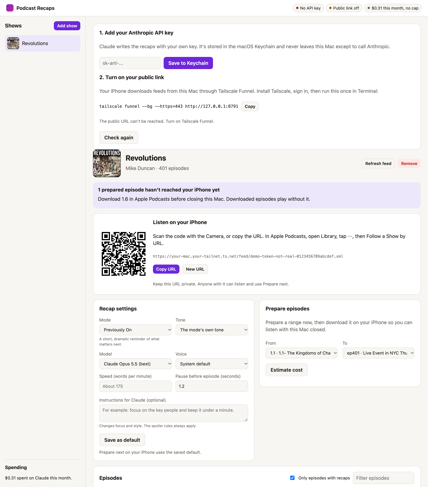
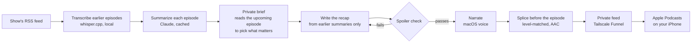

# Podcast Recaps

**Spoiler-safe "previously on" segments for long-running podcasts, spliced into a private copy of the feed in Apple Podcasts.**

Coming back to a serialized show after a break is hard. You've forgotten who's who and what was at stake. Podcast Recaps makes a private copy of a show's feed where each episode you prepare opens with a short, AI-written, narrated recap of what you need to remember, then plays the original episode. It's built from what earlier episodes said, never from what happens next.

It runs on your Mac, with your own Anthropic API key. There's no hosted service and nothing to sign up for.



## What a recap sounds like

Before *Revolutions*, episode 1.5, "Cavaliers and Roundheads":

> Previously, on Revolutions.
>
> January 4, 1642. King Charles marches into the House of Commons with soldiers at his back, come to seize five members. But the birds have flown. The benches stare back at a humiliated king. Six days later, fearing the London crowds, Charles abandons his capital. Months earlier, Ireland had erupted in rebellion. An army had to be raised to crush it. But whose army? …
>
> The king is gone from London. Parliament holds the city. Who will strike first?
>
> And now, Cavaliers and Roundheads.

Then the real episode starts.

## Features

- **Three modes.** *Previously On* is a short, dramatic cold open. *Recap* is a clear catch-up of the story so far. *Further Context* adds cited outside background from the web, which works best for history and true crime.
- **Spoiler checks.** Claude reads the upcoming episode privately to decide which earlier threads matter. A separate check then compares the recap against that episode and rewrites anything that gives it away.
- **Your settings.** Choose the tone, voice, speaking speed, and pause before the episode, and give free-text instructions such as "focus on the key people". The spoiler rules always apply.
- **Prepare next from your phone.** Every episode's show notes link to a confirmation page that prepares the following episode. It's ready in a minute or two.
- **Prepare all before you leave.** Queue a whole range with an upfront cost estimate, download it on your phone, then close your Mac. The UI tells you when every episode has reached your phone.
- **Cost controls.** You see an estimate before every job and can set a monthly cap. Recaps typically cost **$0.13–$0.55** per episode with Claude Opus 5.5, and a cheaper model is available.

## How it works



1. **Transcribe.** Earlier episodes are transcribed locally with [whisper.cpp](https://github.com/ggml-org/whisper.cpp), so this step is free and cached.
2. **Summarize.** Claude summarizes each episode once into a structured summary of events, people, and open threads. Later recaps reuse these summaries.
3. **Plan privately.** Claude reads the upcoming episode's transcript only to decide which earlier threads matter. It lists what that episode reveals so the check can block it. None of this is narrated.
4. **Write and check.** The recap is written from earlier-episode summaries only. A separate pass fails it for spoilers or unsupported claims, and it gets one rewrite. If it still fails, the tool falls back to a plain recap of the last two episodes.
5. **Further Context only:** Claude searches the web for background on real-world references from *earlier* episodes. Only facts tied to a cited passage are kept, and their sources go in the show notes.
6. **Narrate and splice.** A macOS voice reads the recap, which is level-matched to the host and joined to the original audio.
7. **Publish.** A small feed server on your Mac serves a private clone of the feed through [Tailscale Funnel](https://tailscale.com/kb/1223/funnel). Prepared episodes swap in the spliced audio, and the rest point to the original files.

### Tested on

| Show | Kind | Result |
|---|---|---|
| *Revolutions* (Mike Duncan) | Narrative history | All modes pass. Further Context adds cited background on the Grand Remonstrance, the Irish rising of 1641, and John Hampden. |
| *Serial*, season 1 | True crime | All modes pass. Further Context explains Leakin Park and why the case crossed from county to city police. |
| *The Bright Sessions* | Fiction | Previously On and Recap pass. Further Context correctly falls back to Recap, since there's little real-world background to add. |

Before these checks were in place, the evaluation caught recaps that previewed the next episode's settings and reused facts the host explains himself.

## Requirements

- A Mac (Apple silicon recommended) running a recent macOS
- Node.js 22 or later
- An [Anthropic API key](https://console.anthropic.com/), or Claude Code with the plugin below
- [Tailscale](https://tailscale.com/download) with Funnel enabled, so your iPhone can reach the feed from anywhere
- Apple Podcasts on your iPhone
- About 1 GB of disk space for whisper.cpp and its model, plus space for downloaded episodes

## Setup

```sh
git clone https://github.com/alrokosz/podcast-recaps.git
cd podcast-recaps
npm install
```

**Transcription (one time).** Build whisper.cpp with Metal and download the small English model:

```sh
mkdir -p .tools
git clone --depth 1 --branch v1.9.6 https://github.com/ggml-org/whisper.cpp .tools/whisper.cpp
cd .tools/whisper.cpp
cmake -S . -B build -DCMAKE_BUILD_TYPE=Release -DGGML_METAL=ON -DWHISPER_BUILD_TESTS=OFF
cmake --build build -j --config Release --target whisper-cli
sh ./models/download-ggml-model.sh small.en-q5_1
cd ../..
```

If you don't have `cmake`, install it with `brew install cmake` or `pip install cmake`. To use whisper.cpp from somewhere else, set `WHISPER_CLI` and `WHISPER_MODEL`.

**Start the service:**

```sh
npm run serve
```

Then open **http://127.0.0.1:8786**. The page walks you through the rest:

1. Paste your Anthropic API key. It's saved in the macOS Keychain.
2. Turn on your public link by running the Tailscale command it shows once.
3. Add a show by searching Apple Podcasts or pasting a feed URL.
4. Scan the QR code on your iPhone, then follow the show in Apple Podcasts with **Library → ⋯ → Follow a Show by URL**.
5. Prepare an episode or a range.

## Claude Code plugin (no API key)

You can have your own Claude Code session write the recaps on your Claude plan, instead of using an API key. Install the plugin in Claude Code:

```
/plugin install recaps --marketplace alrokosz/podcast-recaps
```

On older versions of Claude Code, use `/plugin marketplace add alrokosz/podcast-recaps`, then `/plugin install recaps@podcast-recaps`.

Then:

```
/recaps:setup                          install and start the local service, check transcription and Tailscale
/recaps:add Revolutions                add a show and get its private feed URL
/recaps:prepare Revolutions 1.7-1.12   write recaps for a range of episodes in this session
/recaps:status                         see what's ready and what's waiting
```

`/recaps:prepare` shows what it will write and asks before starting. Each step runs in a fresh subagent: summaries, the private brief, research, and the script. The spoiler check always runs in a separate reviewer agent that didn't write the recap. The service validates every result against the same schemas the API path uses, then narrates, splices, and publishes each episode as it finishes.

The plugin still needs the local service, and Tailscale for listening on your iPhone. It never runs Claude in the background. Episodes queued with Prepare next on your phone wait until you next run `/recaps:prepare`. To prepare on demand while your Mac is unattended, add an API key in the web UI.

## Command line

Everything in the UI is also available without it:

```sh
npm run recaps -- key set                 # save your API key to the Keychain (input is hidden)
npm run recap -- --feed <rss-url> --list  # list a feed's episodes
npm run recap -- --feed <rss-url> --episode 1.5 --mode further-context --tone documentary
npm run recap -- --help
```

`make` writes the spliced `.m4a`, the recap text, and any sources to the data folder. Data lives in `~/.podcast-recaps`, and you can set `RECAPS_HOME` to move it. The npm scripts use `./work` for development.

## Privacy and security

- **No server of mine is involved.** Your key, your transcripts, and the audio stay on your Mac. Text is sent only to Anthropic, and web searches run only in Further Context.
- **The API key** lives in the macOS Keychain. It's never written to config files, logs, or feeds, and the API never returns it.
- **The local UI and API** listen on `127.0.0.1` only. They reject requests from other hosts (DNS rebinding) and from other websites (cross-site requests). Tailscale Funnel exposes a separate server that serves only feeds, audio, and the Prepare next page.
- **Feeds** use a long random token in the URL, are marked `itunes:block` and `noindex`, and can be revoked with a new URL at any time.
- **Feed content is untrusted.** Transcripts and show notes are passed to Claude as data, never as instructions, and the UI inserts them as plain text.

## Personal use only

Podcast Recaps doesn't host, share, or redistribute anyone's podcast. Each private feed serves episodes you downloaded, for your own listening. Recaps are labeled as unofficial and AI-generated. Respect the rights of the shows you use it with, and don't share your feed URLs.

## Project layout

```
src/
  feed.ts        RSS parsing, episode ordering, and labels
  transcribe.ts  Downloads and local whisper.cpp transcription
  recap.ts       Prompts and schemas: summaries, brief, script, spoiler check, research
  llm.ts         Claude client: structured output, web search with citations, cost tracking
  modes.ts       Modes and tone presets
  pipeline.ts    The end-to-end recap pipeline
  audio.ts       macOS narration, WAV splicing, loudness matching
  store.ts       SQLite (node:sqlite): shows, episodes, jobs, usage, deliveries
  worker.ts      One-at-a-time job queue with resume and a monthly cap
  server.ts      Local JSON API and web UI (loopback only)
  public.ts      Public feed server: feeds, audio ranges, Prepare next
  feedxml.ts     Builds the private cloned feed
  ui/            The web UI: plain HTML, CSS, and JS, no build step
  writer.ts      The RecapWriter interface: the API (llm.ts) or a Claude Code session (packets.ts)
  packets.ts     Work packets that wait for a Claude Code session
plugin/          The Claude Code plugin: skills, subagents, and a dependency-free MCP server
spike/           The original Apple Podcasts feed experiment
```

## Development

```sh
npm test           # unit and API tests (no network, no API calls)
npm run typecheck
```

## Roadmap

- Verify web sources quoted by the Claude Code plugin, as the API path's citations already are
- Higher-quality local voices, such as Kokoro, and optional hosted voices
- An npm package with one-command setup

---

Built with [Claude Code](https://claude.com/claude-code).

## License

[MIT](LICENSE). The license covers this code, not the podcasts you use it with.
